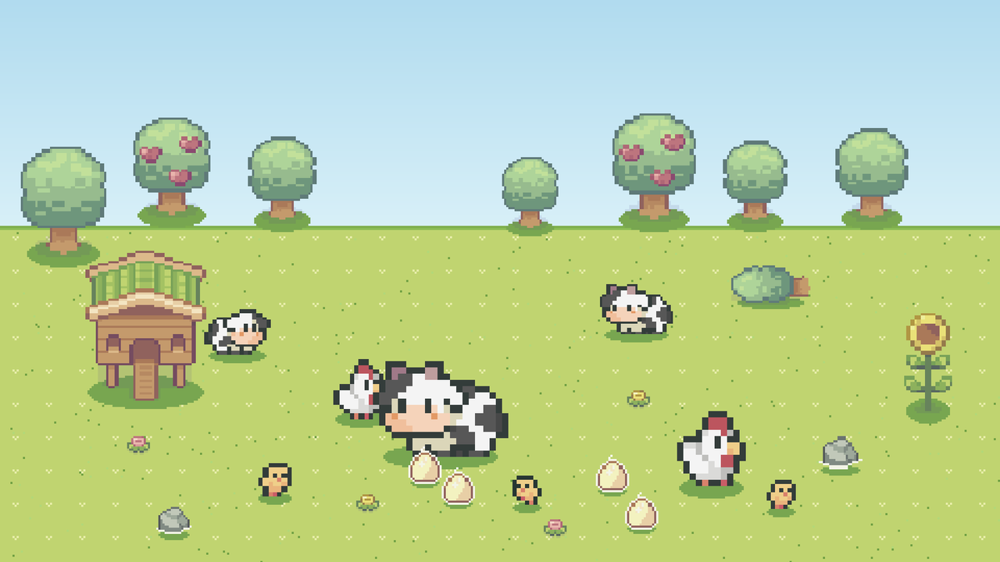
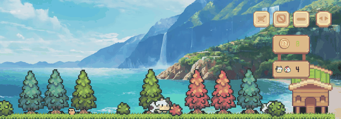
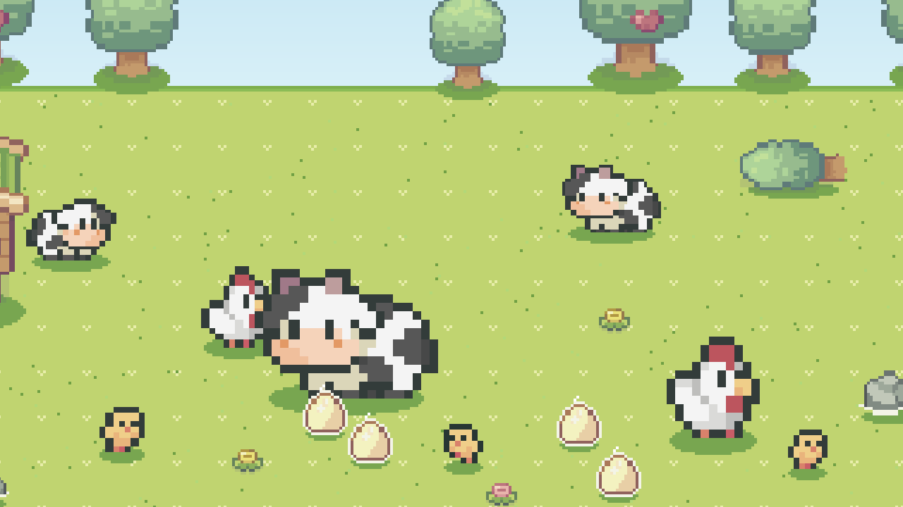

# Animal Farm

**A tiny pixel farm that lives on your desktop.** Chickens wander, cows graze, an egg pops out every few seconds — click it, collect the coins, buy more animals.

---

## Download

| Platform | File | Size |
|---|---|---|
| Windows 10 / 11 (64-bit) | **[AnimalFarm_Windows.zip](../../releases/latest)** | 30 MB |

Unzip anywhere and run `AnimalFarm.exe`. No installer, no admin rights, nothing to configure.

> Windows SmartScreen will warn on first run because the build is not code-signed:
> click **More info → Run anyway**.
> Some antivirus engines also flag unsigned Unity/Tuanjie players — false positive.

## How to play

The game has **no window and no borders**. It draws a patch of grass on top of your desktop, and everything outside the farm is transparent — that is the game, not a bug.

| Action | How |
|---|---|
| Move the farm | hold left mouse button on the grass and drag |
| Collect an egg | click the egg (100 coins) |
| Open the shop | basket icon on the right panel — hen 100, chick 50 |
| Shrink the farm | minus icon (tap again to restore) |
| Hide the UI | eye icon |
| Erase progress | trash icon |
| Quit | exit icon → Yes |

Coins and animals are auto-saved every 30 seconds. Save folder:
`%USERPROFILE%\AppData\LocalLow\DefaultCompany\桌面动物牧场`

## Screenshots

| | |
|---|---|
|  |  |

## FAQ

**The farm is stuck in a corner / behind the taskbar.**
Drag it by the grass. It remembers nothing about position, so drag it wherever you like each session.

**Nothing happens when I click outside the farm.**
That area is transparent and click-through on purpose — clicks go to whatever is behind it.

**Antivirus deleted the exe.**
False positive on the unsigned Tuanjie player. Add an exclusion or rebuild from source with your own signing certificate.

**Does it work on Mac / Linux?**
No. The transparent always-on-top window is Win32-specific.

## Requirements

- Windows 10 or 11, 64-bit
- DirectX 11 capable GPU (any integrated GPU from the last decade is enough)
- ~90 MB free disk space

## Credits

- **Pixel art:** [Sprout Lands](https://cupnooble.itch.io/) by **Cup Nooble** — used under the Basic Pack license (non-commercial, attribution required).
- **Engine:** Tuanjie Engine 2022.3 (Unity China).

## License

The game build is released **free of charge for personal, non-commercial use**.
Redistribution of the Sprout Lands art assets on their own is not allowed.
All rights to the game itself remain with the author.

---

# 中文说明

**一个住在桌面上的小牧场。** 鸡在草地上啄食，牛来回踱步，每隔几秒下一颗蛋——点一下蛋收金币，攒够钱去商店买新动物。

## 下载

到本仓库的 **[Releases](../../releases/latest)** 页面下载 `AnimalFarm_Windows.zip`（约 30 MB），解压后双击 `AnimalFarm.exe`。

首次运行 Windows 会弹「已保护你的电脑」，点 **更多信息 → 仍要运行**（构建没有代码签名，属正常）。

## 怎么玩

游戏**没有窗口边框**，它把一片草地画在桌面上，农场以外的区域是透明的——这是设计，不是 bug。

| 操作 | 方式 |
|---|---|
| 移动牧场 | 按住草地拖动 |
| 收鸡蛋 | 点鸡蛋，+100 金币 |
| 商店 | 右侧篮子图标，母鸡 100 / 小鸡 50 |
| 缩小 | 减号图标（再点恢复） |
| 隐藏 UI | 眼睛图标 |
| 清档 | 垃圾桶图标 |
| 退出 | 退出图标 → 是 |

存档每 30 秒自动保存，位置：`%USERPROFILE%\AppData\LocalLow\DefaultCompany\桌面动物牧场`

## 素材与授权

- 像素素材：[Sprout Lands](https://cupnooble.itch.io/) / **Cup Nooble**，Basic Pack 许可（**仅限非商业用途，必须署名**）
- 引擎：团结引擎 2022.3

> ⚠️ 因为素材是 Basic Pack（非商业许可），这个版本**不能**用于挂广告、收打赏、上架售卖。要商用（比如接广告平台、Steam 收费）需要先向 Cup Nooble 购买商业授权，或替换掉这套素材。
